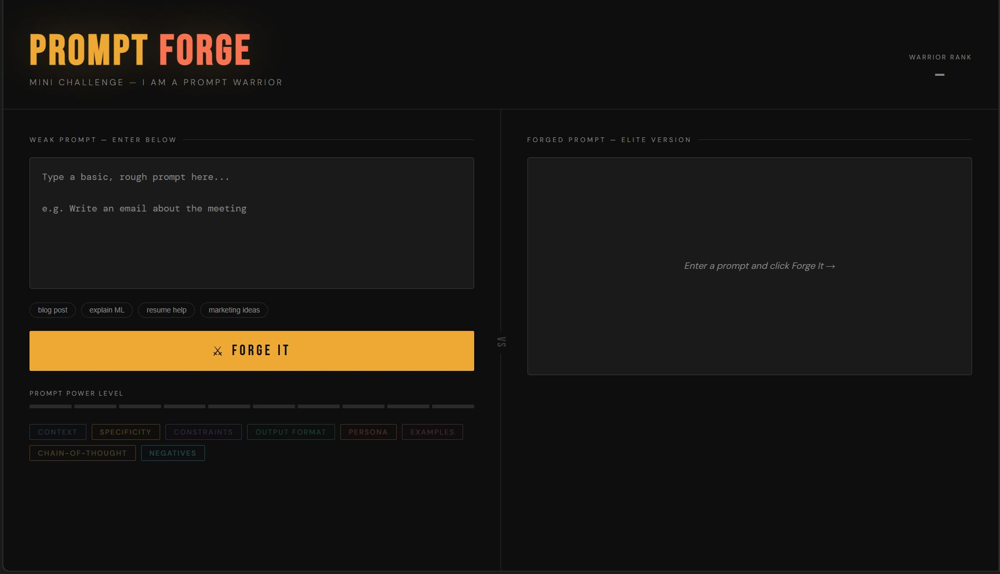

<div align="center">

  

  <h1>⚔️ Prompt Forge</h1>
  <p><strong>Transform weak prompts into elite, production-ready prompts using NVIDIA NIM</strong></p>

  <p>
    <a href="https://prompt-forge-o970.onrender.com">
      
    </a>
    
    
    
    
    
  </p>

  <p><em>Paste a rough idea → Hit "Forge It" → Get an elite prompt with power scoring, technique breakdown, and Warrior Analysis ✨</em></p>

</div>

---

## 🚀 Live Demo

**[→ Try Prompt Forge Live](https://prompt-forge-o970.onrender.com)**

Paste a weak prompt → Hit Forge It → Watch the magic ✨

---

## 📸 Screenshots

### ⚔️ Forge Interface — Prompt Engineering Tool with NVIDIA NIM



---

## 🛠️ Built With — Python Flask, NVIDIA NIM API, Vanilla JS

| Layer | Technology |
|-------|-----------|
| Frontend | Vanilla HTML / CSS / JavaScript (single file) |
| Backend | Python · Flask · python-dotenv · requests |
| AI Model | Configurable via `NVIDIA_MODEL` (default `deepseek-ai/deepseek-v4.1-flash`) |
| API | NVIDIA NIM API |
| Fonts | Bebas Neue · DM Sans · DM Mono (Google Fonts) |

---

## ✨ Features — Prompt Forging, Technique Detection, Power Scoring

**Prompt Forging Engine** — Rewrites any weak prompt into a detailed, elite-grade version (3–8× longer) using an NVIDIA-hosted LLM via the NVIDIA NIM API.

**8 Prompt Engineering Technique Tags** — Detects and highlights which techniques were applied:
`Context` · `Specificity` · `Constraints` · `Output Format` · `Persona` · `Examples` · `Chain-of-Thought` · `Negatives`

**Power Level Meter (1–10)** — Scores the upgrade from 1–10, visualised as a 10-bar indicator.

**Warrior Rank System** — Earn a rank based on your power level: `RECRUIT` → `BRONZE` → `SILVER` → `GOLD` → `LEGENDARY`

**Warrior Analysis Panel** — A 2–3 sentence explanation of every key improvement made to your prompt.

**Typewriter Output Animation** — Forged prompt streams in character-by-character for dramatic effect.

**One-Click Copy** — Instantly copy the forged prompt to clipboard.

**Quick-Fill Examples** — Pre-loaded starters: blog post, explain ML, resume help, marketing ideas.

**Keyboard Shortcut** — `Ctrl + Enter` / `Cmd + Enter` to forge instantly.

**Responsive Design** — Fully usable on mobile and tablet screens.

---

## 🗂 Project Structure

```
prompt_forge/
├── static/
│   └── prompt_warrior.html   # Frontend — single-file UI (HTML + CSS + JS)
├── server.py             # Backend — Flask API that calls the NVIDIA NIM API
├── requirements.txt      # Python dependencies
├── .env                  # Your API key (never committed)
├── .env.example          # Template for environment setup
├── .gitignore            # Standard Python/IDE ignore rules
└── README.md             # This file
```

---

## 🚀 Getting Started — Quick Setup Guide for Prompt Forge

### 1. Clone the repository

```bash
git clone https://github.com/Divyansh0208/Prompt_Forge.git
cd Prompt_Forge
```

### 2. Create and activate a virtual environment

```bash
python -m venv venv

# macOS / Linux
source venv/bin/activate

# Windows
venv\Scripts\activate
```

### 3. Install dependencies

```bash
pip install -r requirements.txt
```

### 4. Set up environment variables

```bash
cp .env.example .env
```

Open `.env` and add your NVIDIA API key:

```
NVIDIA_API_KEY=your-nvidia-api-key-here
# optional: NVIDIA_MODEL=deepseek-ai/deepseek-v4.1-flash
```

Get your free API key at [build.nvidia.com](https://build.nvidia.com).

### 5. Run the server

```bash
python server.py
```

For production (e.g. Render), use `gunicorn server:app` as the start command.

### 6. Open the app

Visit `http://localhost:8000` in your browser.

---

## 🔑 Environment Variables

| Variable | Required | Description |
|----------|----------|-------------|
| `NVIDIA_API_KEY` | ✅ Yes | API key from [build.nvidia.com](https://build.nvidia.com) |
| `NVIDIA_MODEL` | No | Model ID (default `deepseek-ai/deepseek-v4.1-flash`). Change it if NVIDIA retires the model. |

The API key is loaded server-side via `python-dotenv` and is **never exposed to the browser**.

---

## 🧠 How It Works — Prompt Forging Pipeline Explained

1. Enter a weak or rough prompt in the left panel.
2. Click **Forge It** — frontend sends `POST /api/forge` to the Flask server.
3. Flask builds the request, adds a detailed system prompt, and calls the **NVIDIA NIM API**, instructing the model to act as a master prompt engineer.
4. The model returns a structured JSON response:
   - `forged_prompt` — the upgraded prompt text
   - `techniques_used` — list of techniques applied
   - `power_level` — integer score from 1 to 10
   - `analysis` — explanation of improvements
5. Frontend renders the forged prompt with typewriter animation, lights up technique tags, fills the power meter, assigns a Warrior Rank, and shows the Warrior Analysis.

---

## 📡 API Reference — NVIDIA NIM Proxy Endpoint

### `POST /api/forge`

Forges a weak prompt. The server builds the NVIDIA request itself.

**Request Body:**

```json
{ "weak": "write a blog post" }
```

**Response:** the forged JSON (`forged_prompt`, `techniques_used`, `power_level`, `analysis`), or `{ "error": "..." }` with a 4xx/5xx status.

---

## 🎖 Warrior Rank Scale — Prompt Power Level System

| Power Level | Warrior Rank |
|-------------|-------------|
| 0 | — |
| 1 – 2 | 🪖 RECRUIT |
| 3 – 4 | 🥉 BRONZE |
| 5 – 6 | 🥈 SILVER |
| 7 – 8 | 🥇 GOLD |
| 9 – 10 | 🏆 LEGENDARY |

---

## 🤝 Contributing

Contributions are welcome! Fork the repo, make your changes, and open a pull request. For major changes, open an issue first to discuss what you'd like to change.

---

## 📜 License — MIT License for Open Source

This project is licensed under the [MIT License](LICENSE).

Created for **Google Prompt Wars 2026**.

---

<div align="center">
  <strong>Powered by NVIDIA NIM · Built with ⚔️ by <a href="https://github.com/Divyansh0208">Divyansh0208</a></strong>
</div>
